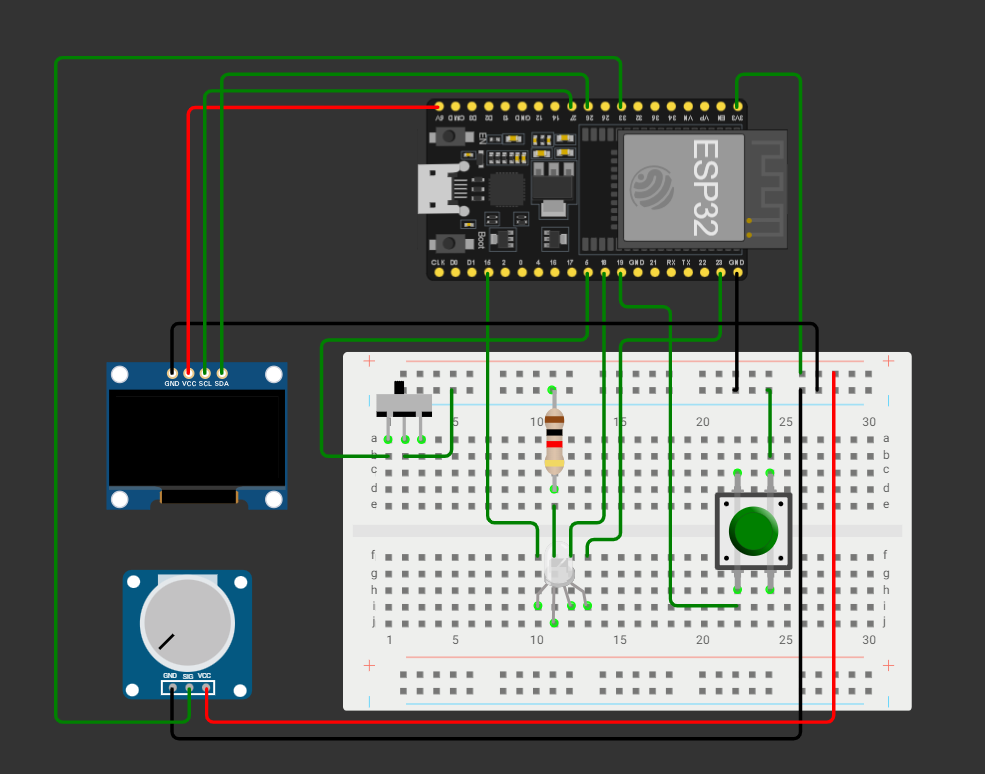
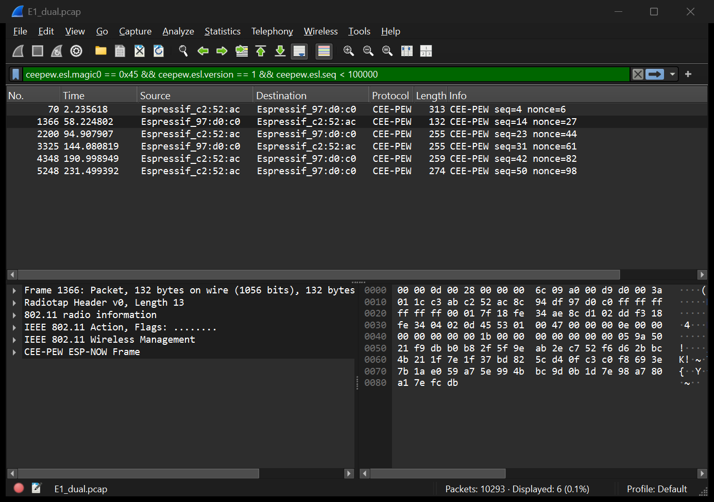

<p align="center">
  
</p>

<p align="center">
  <a href="LICENSE"></a>
  
  
  
  
  
  <a href="results/registry.json"></a>
  <a href="results/registry.json"></a>
</p>

---

# CEE-PEW
### Zero-Heap, Side-Channel Hardened P2P Wireless Mesh Firmware for ESP32

CEE-PEW (**C**ryptographic **E**nd-to-**E**nd **P**eer-to-peer **E**ncrypted **W**ireless Communicator) is an embedded secure messaging firmware engineered in **C99/FreeRTOS** for resource-constrained microcontrollers (**ESP32 dual-core Xtensa LX6**). Operating over raw **802.11 vendor Action frames via ESP-NOW**, CEE-PEW completely bypasses Wi-Fi access points, cellular towers, and centralized cloud brokers to provide autonomous, air-gapped encrypted communication.

By eliminating dynamic heap allocation (`malloc`/`free`) in favor of a static region bump allocator and a deterministic 16-stage bounded pipeline, CEE-PEW achieves zero heap fragmentation, sub-3 ms over-the-air frame airtimes, and fail-closed by construction (no formal proof). Discovery and pairing are negotiated out-of-band over BLE GATT with 4-character visual PIN commitment before tearing down the Bluetooth stack and handing off cleanly to an encrypted ESP-NOW session.

<p align="center">
  <a href="#performance--wire-budget-at-a-glance"><b>⚡ Performance & Wire Budget</b></a> &nbsp;•&nbsp;
  <a href="#system-architecture"><b>🏗️ System Architecture</b></a> &nbsp;•&nbsp;
  <a href="#protocol--packet-dissection"><b>📡 Protocol & Dissection</b></a> &nbsp;•&nbsp;
  <a href="#quickstart"><b>🚀 Quickstart</b></a> &nbsp;•&nbsp;
  <a href="#documentation-hub"><b>📖 Documentation</b></a>
</p>

---

## Performance & Wire Budget at a Glance

| Metric | Target / Capability | Architecture Implementation | Evidence |
|---|---|---|:---:|
| **0 Bytes** | **Application Heap Allocation** | 48 KB static bump region pool; zero memory fragmentation | `M-HW` |
| **249 Bytes** | **Over-the-Air Wire Budget** | Full profile fits strictly within 802.11 Action frame limit (250 B) | `C` |
| **2.53 ms** | **802.11 MPDU Airtime** | 1 Mbps DSSS airtime for 249 B frame (2.84 ms with hardware ACK) | `C` |
| **138 B / 105 B** | **Lite Profile Wire Size** | Symmetric streaming (138 B with FEC, 105 B without FEC) | `C` |
| **0 Bytes** | **Cleartext Air Leakage** | 100% payload encrypted with Ascon-128 v1.2 (Shannon entropy: 7.99 bits/B) | `M-HW` |
| **100 / 100** | **Replay Vectors Rejected** | 64-bit sliding window with commit-after-authentication rule | `M-HOST` |
| **22 / 22** | **Host Test Suites Passing** | ASan/UBSan unit suites (Curve25519, Ascon, Ed25519, Salsa20, HMAC, FEC, ARQ) | `M-HOST` |
| **14 / 14** | **Hardware Diagnostics Passing** | On-chip diagnostic report verifying crypto, timers, memory, and FSM | `M-HW` |

*Evidence classes follow IEEE reproducibility guidelines: `M-HW` (hardware-measured on ESP32), `M-HOST` (host harness), `C` (exact equation).*

---

## Key Capabilities

- **Zero-Heap Memory Architecture**: Replaces the heap with a 48 KB static bump region allocator ([`ceepew_region.h`](components/mem/ceepew_region.h)). Eliminates runtime fragmentation, allocation latency, and out-of-memory faults.
- **7-Layer Defense-in-Depth Cryptography**: Incorporates X25519 ECDH (RFC 7748), Ed25519 signatures (RFC 8032), HKDF-SHA256 (RFC 5869), Ascon-128 v1.2 AEAD, a non-cryptographic digital-root salt diversification helper (security does not depend on it), and 64-bit sliding-window anti-replay.
- **Hardware-Gated Identity & BLE Pairing**: Ephemeral BLE GATT handshake with mutual PIN commitment (~20.7 bits brute-force resistance against active MITM) before tearing down BLE to hand off cleanly to ESP-NOW.
- **Forward Error Correction (FEC) & ARQ**: Hamming(15,11) codec with single-bit correction and double-bit error detection coupled to Stop-and-Wait ARQ with exponential backoff.
- **Dual-Core FreeRTOS Task Isolation**: Core 0 exclusively drives UI rendering, button debouncing, and ADC rotary input; Core 1 executes session state machine, cryptography, and radio dispatch.
- **Side-Channel Hardening**: Constant-time secret comparisons via `crypto_ct_equal()`, compile-time deadman zeroing (`ceepew_secure_zero()`), and hardware eFuse HMAC key burning.

---

## System Architecture

<p align="center">
  
</p>

The firmware partitions operations across ESP32 cores via FreeRTOS queues:
- **Core 0 (UI Task)**: Samples 10 kΩ potentiometer (ADC1_CH5 / GPIO33) with moving-average filtering, debounces action (GPIO19) and diagnostic (GPIO5) buttons, and renders UI screens to SSD1306 OLED (GPIO26/27, 400 kHz Fast-Mode I2C).
- **Core 1 (Session & Crypto Task)**: Manages three-phase pairing FSM (BLE to ESP-NOW handoff), derives ephemeral keys via HKDF-SHA256, encrypts frames with Ascon-128 v1.2, and coordinates channel hopping.
- **IPC Safety**: Queues (`g_ui_event_queue`, `g_session_rx_queue`) decouple core operations without shared mutable memory or blocking waits.

---

## Protocol & Packet Dissection

<p align="center">
  
</p>

Promiscuous 802.11 capture decoded via custom Wireshark dissector ([`tools/capture/wireshark/ceepew_espnow.lua`](tools/capture/wireshark/ceepew_espnow.lua)):
- **Wire Budget**: Payload ($P_c = 58\text{ B}$), Ascon-128 v1.2 ciphertext + tag, Ed25519 signature ($64\text{ B}$), and Hamming(15,11) parity bytes fit within **249 B** (under the 250 B ESP-NOW ceiling).
- **Cryptographic Entropy**: Unencrypted frames show structured ASCII ($4.48\text{ bits/B}$); CEE-PEW achieves near-ideal pseudo-randomness (**$7.99\text{ bits/B}$**) with zero cleartext leakage.

---

## Architectural Comparison

| Dimension | Conventional MQTT / Wi-Fi | Standard ESP-NOW | **CEE-PEW Firmware** |
|---|---|---|---|
| **Network Topology** | Centralized AP & Cloud Broker | Raw Broadcast Frames | **Decentralized Direct P2P Mesh** |
| **Authentication** | TLS Certificate / Cloud Identity | Vendor MAC Filtering Only | **Mutual Ed25519 + X25519 ECDH Handshake** |
| **Payload Privacy** | Cleartext on LAN (unless TLS) | Cleartext over the air | **Ascon-128 v1.2 AEAD (0 B cleartext leakage)** |
| **Error Recovery** | TCP Windowing | Best-effort / Hardware ACK | **Hamming(15,11) FEC + Stop-and-Wait ARQ** |
| **Memory Model** | Dynamic Heap (`malloc`/`free`) | Ad-hoc SDK allocations | **Zero-Heap 48 KB Static Region Allocator** |
| **Anti-Replay** | TLS Sequence Counters | None (vulnerable to replay) | **64-bit Sliding Window (Commit-after-Auth)** |
| **Infrastructure** | Inoperable without AP / Internet | Inoperable beyond single hop | **Autonomous & Air-Gapped Operation** |

---

## Quickstart

### 1. Host C Unit Tests & Sanitizers (Zero Hardware Required)
Run the native unit test suite with GCC/Clang AddressSanitizer and UndefinedBehaviorSanitizer:
```bash
python tools/ceepew_pipeline.py --mode host
```
*Validates all 22 unit test suites: Curve25519/X25519 ECDH, Ascon-128 v1.2 KAT, Ed25519, HKDF-SHA256, HMAC-SHA256, Salsa20, PKCS#7 padding, static Huffman, Hamming(15,11) FEC fault injection, replay window, side-channel timing uniformity, and fail-closed pairing policy.*

### 2. Verify Protocol Arithmetic & Wire Budgets
Recompute all wire budgets, airtimes, cycle-to-time formulas, and bounds against `results/registry.json`:
```bash
python tools/recompute_paper_numbers.py
```

### 3. Build Firmware
Initialize the ESP-IDF environment (v6.0.3) and compile the firmware:
```bash
# Full Profile (Default: 7-layer stack, Ed25519 signatures, Hamming FEC)
idf.py build

# Lite Profile (High-throughput symmetric streaming, optional FEC disabled)
idf.py -B build_lite -D CONFIG_CEEPEW_FEC_DISABLE=y build
```

### 4. Flash & Launch Pairing Integration Test
Flash both target ESP32 boards in parallel and monitor end-to-end BLE pairing and encrypted ESP-NOW communication:
```powershell
# Windows PowerShell driver (auto-detects ports or pass overrides):
.\tools\flash_both.ps1 -Port1 COM5 -Port2 COM6

# Or via cross-platform pipeline runner:
python tools/ceepew_pipeline.py --mode pairing --port1 COM5 --port2 COM6
```

### 5. On-Device Boot Diagnostics (Single Device)
Run the automated 14-subsystem on-device boot self-test:
```bash
python tools/ceepew_pipeline.py --mode diag
```

### 6. OTA Sniffer Board (3rd ESP32 on COM6)
Build, flash, and use the dedicated promiscuous sniffer for OTA packet capture:

```powershell
# Build sniffer firmware (separate build dir, does not collide with DUT builds)
idf.py -B build_sniffer build

# Flash to sniffer board (COM6)
idf.py -B build_sniffer -p COM6 flash

# Capture sniffer output while DUTs exchange traffic
python tools/ceepew_monitor.py --port COM6 --duration 900 --log data/raw/<run>/sniffer_com6.log

# Convert UART hex dump to Wireshark PCAP
python tools/capture/serial_to_pcap.py --radiotap data/raw/<run>/sniffer_com6.log `
  --out data/raw/<run>/<run>_sniffer.pcap
```

Full capture plan and hardware notes: [`tools/capture/ota_sniffer_plan.md`](tools/capture/ota_sniffer_plan.md).
Sniffer component: [`components/sniffer/`](components/sniffer/) (library `sniffer.c`/`sniffer.h` + example apps `sniffer_app.c` and `sniffer_minimal.c`).

---

## Documentation Hub

| Document | Focus & Scope |
|---|---|
| 🏗️ [**Architecture Guide**](ARCHITECTURE.md) | Dual-core task affinity, state machine transitions, FreeRTOS queue IPC |
| 🛡️ [**Security Policy & Threat Model**](SECURITY.md) | Threat boundaries, side-channel mitigations, responsible disclosure |
| 📊 [**Results Registry**](results/registry.json) | Canonical JSON ledger of all quantitative claims, timings, and evidence |
| 🔬 [**Results Documentation**](results/README.md) | Recomputation instructions, evidence classes (`M-HW`, `M-HOST`, `C`, `S`) |
| 🐞 [**Device Log Findings**](DEVICE_LOG_FINDINGS.md) | Continuous hardware log analysis and auto-detected bug signature index |
| 🤝 [**Contributing Guide**](CONTRIBUTING.md) | Coding style, zero-heap constraints, PR checklist, and test gates |
| ⚖️ [**License (GPL-3.0)**](LICENSE) | GNU General Public License terms and conditions |

---

## Verification & Test Integrity

CEE-PEW enforces strict, reproducible verification across every layer of the system:
- **22 Host C Unit Suites**: Compiled with `-fsanitize=address,undefined` on host toolchains with 100% assertion pass rate.
- **Hardware Boot Diagnostics**: Automated on-chip self-test verifying 14 subsystems including AES/Ascon, FSM convergence, key derivation, and low-order point rejection.
- **Over-the-Air PCAP Analysis**: Promiscuous packet captures analyzed for exact wire byte budgets, Shannon entropy ($7.99\text{ bits/B}$), and cleartext absence.
- **Automated Signature Analysis**: Device logs ingested via `ceepew_log_pipeline.py` to continuously track hardware regressions against known failure signatures.

---

## Publication Gate Standard

After any revision to the paper manuscript (`docs/paper/The Paper/main.tex`), the **full publication loop** must be run before the revision is considered complete. This prevents citation drift, unresolved references, and arithmetic inconsistencies from entering the final PDF.

### Mandatory Loop Steps (in order)

```powershell
# Step 1: Clean aux files and compile 3× pdflatex to resolve all references
cd docs\paper\The Paper\FINAL
del *.aux *.log *.out *.toc *.lof *.lot *.bbl *.blg 2>$null
pdflatex -interaction=nonstopmode ceepew_unrestricted.tex
pdflatex -interaction=nonstopmode ceepew_unrestricted.tex
pdflatex -interaction=nonstopmode ceepew_unrestricted.tex

# Step 2: Verify main.tex and FINAL/ceepew_unrestricted.tex are byte-identical
(Get-Content docs\paper\The Paper\main.tex -Raw) -eq (Get-Content docs\paper\The Paper\FINAL\ceepew_unrestricted.tex -Raw)

# Step 3: Run publication gate (offline)
python tools/publication_gate.py --paper the_paper

# Step 4: Run publication gate (external / Crossref + OpenAlex)
python tools/publication_gate.py --paper the_paper --external

# Step 5: Verify arithmetic against results/registry.json
python tools/recompute_paper_numbers.py

# Step 6: Run host C unit tests
python tools/ceepew_pipeline.py --mode host
```

**Exit criteria**: All steps must PASS (0 fail). Warnings are acceptable for offline-only checks (OpenAlex rate limits, documented arithmetic exceptions). Every gate run writes an artifact under `docs/paper/publication_gates/`. A submission without a same-day gate artifact is not authorised.

See [`docs/paper/The Paper/OPENCODE_INSTRUCTIONS.md` §E](docs/paper/The%20Paper/OPENCODE_INSTRUCTIONS.md) for the complete loop specification.
