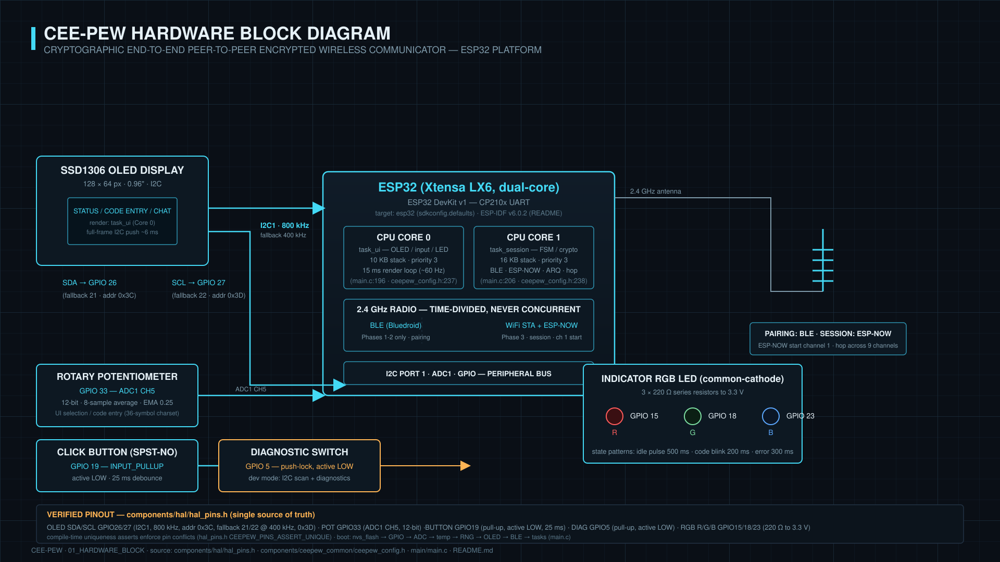

<p align="center">
  
</p>

# CEE-PEW

**C**ryptographic **E**nd-to-**E**nd **P**eer-to-peer **E**ncrypted **W**ireless Communicator

ESP32-based secure messaging with a 7-layer cryptographic stack, pairing via BLE, and encrypted chat over ESP-NOW.

[](LICENSE)
[](https://idf.espressif.com/)
[](https://www.espressif.com/)

---

## Features

- **End-to-end encrypted messaging** — 7-layer crypto stack (Curve25519 ECDH, Ed25519 EdDSA, HKDF-SHA256, HMAC-SHA256, Ascon-128 AEAD, digital_sum_mix, nonce counter + expiry)
- **User-verified PIN pairing** — 4-character one-time PIN provides ~13.3 bits (log2(10^4), numeric) of brute-force resistance against active MITM during the ~45 s pairing window
- **Hardware-gated identity handoff** — BLE discovery/pairing, then handoff to ESP-NOW for session transport
- **Forward error correction** — Hamming(15,11) on every frame; Stop-and-Wait ARQ with exponential backoff
- **Zero heap allocation** — 48 KB static region allocator; all session state in compile-time structures
- **Dual-core FreeRTOS** — UI on Core 0, session crypto on Core 1; IPC via FreeRTOS queues only
- **Static Huffman compression** — Lossless message compression
- **ESP-NOW channel hopping** — Frequency diversity for the session transport

## Hardware & Circuit Schematics

| Component | Pin / Interface | Specification |
|-----------|-----------------|--------------|
| **MCU** | ESP32 DevKit v1 | 240 MHz dual-core Tensilica Xtensa LX6, 4 MB SPI Flash, CP210x UART |
| **Display** | I2C (SDA=GPIO26, SCL=GPIO27) | SSD1306 128×64 Monochrome OLED (400 kHz Fast-Mode I2C) |
| **Navigation Input** | ADC1_CH5 (GPIO33) | 10 kΩ rotary potentiometer with moving-average filtering |
| **Action Button** | GPIO19 (Active LOW) | Momentary click switch with 20 ms software debouncing |
| **Diagnostic Switch**| GPIO5 (Active LOW) | Hardware push-lock switch enabling on-boot diagnostic test suite |
| **Status Indicator** | GPIO15 (R), GPIO18 (G), GPIO23 (B) | Common-cathode RGB LED (220 Ω current-limiting resistors to 3.3 V) |

### Engineering Schematic & Block Diagram

<p align="center">
  
</p>

---

## Testing Methodologies & Reproduction Guide

CEE-PEW enforces a multi-tier testing and verification framework. Anyone checking out this repository can independently reproduce, test, and audit every claim in the paper.

### 1. Host-Side C Unit Tests & Sanitizers (Zero Hardware Required)
Run the native host test suite with GCC/Clang AddressSanitizer and UndefinedBehaviorSanitizer:
```powershell
python tools/ceepew_pipeline.py --mode host
```
*Verifies: 15/15 test suites (Ascon-128 KAT, Ed25519, HKDF-SHA256, static Huffman, Hamming(15,11) FEC single-bit correction and double-bit non-crashing bounds, 64-bit replay sliding window, replay vectors, PFS auth, UI navigator, and side-channel timing uniformity).*

### 2. Paper Arithmetic & Claim Verification
Recompute all 45 formulas, wire budgets, airtimes, cycle-to-time conversions, and bounds reported in the paper:
```powershell
python tools/recompute_paper_numbers.py
```
*Directly validates: Wire budgets (249 B Full, 138 B Lite), efficiencies (23.3%, 42.0%, 55.2%), 802.11 airtimes (2.528 ms MPDU, 0.304 ms ACK), and entropy bounds.*

### 3. On-Device Boot Diagnostics (Single ESP32)
Enable diagnostic mode to run the 14-subsystem boot self-test on physical hardware:
```powershell
python tools/ceepew_pipeline.py --mode diag
```
*Verifies: 14/14 subsystems print `PASS` in the `=== DIAGNOSTIC REPORT ===` (FSM transitions, 2^56 nonce hard-limit enforcement, memory pool ownership, PRG channel hopping synchronization, OLED facade, and internal temp sensor).*

### 4. Two-Device Pairing & Protocol Integration Test
Flash both target boards and monitor end-to-end BLE discovery, PIN verification, and ESP-NOW session transport:
```powershell
python tools/ceepew_pipeline.py --mode pairing
```
*Captures: Three-phase pairing sequence, BLE GATT handoff, rendezvous clock-offset calibration, and active bidirectional encrypted chat.*

### 5. Automated Log Pipeline & Bug Signature Detection
Ingest device monitor logs to detect anomalies and cross-reference against known failure signatures:
```powershell
python tools/ceepew_log_pipeline.py ingest logs/pairing_*.txt --report
```
*Generates: Cross-run anomaly tracking and structured findings in `DEVICE_LOG_FINDINGS.md`.*

### 6. Over-the-Air Capture Rig & PCAP Analysis
Verify OTA wire behavior, Shannon entropy, and cleartext absence using promiscuous mode packet captures:
```powershell
# Analyze captured 802.11 ESP-NOW frames from data/raw/
python tools/capture/mode_report.py data/raw/E1_B_ccmp_20261017/DEVICE_A.pcap --mode "CCMP"
```

### 7. Production Readiness Audit
Audit firmware security flags before deployment:
```powershell
python tools/ceepew_pipeline.py --mode prod
```
*Checks: Secure Boot v2, Flash Encryption, dev mode disabled, and flash partition sizing.*

---

## Empirical Results & Testing Data

All quantitative claims and experimental datasets used in the paper are published and tracked in this repository:
- **Canonical Results Registry**: [`results/registry.json`](results/registry.json) (every number tagged with an Evidence Class: `M-HW`, `M-HOST`, `C`, `S`, or `E`).
- **Results Documentation**: [`results/README.md`](results/README.md) (complete results ledger and analysis).
- **Experimental Datasets**: [`data/`](data/) (raw PCAPs, serial logs, SHA-256 manifests, and derived CSVs).

### Key Empirical Results Summary

| Property / Metric | Evaluated Value | Baseline / Comparison | Evidence Class | Source / Dataset |
|-------------------|-----------------|-----------------------|----------------|------------------|
| **Wire Frame Size ($P_c=58\text{ B}$)** | **249 B** | ESP-NOW v1.0 ceiling (250 B) | `C` | [`results/registry.json`](results/registry.json#L31) |
| **Lite Profile Wire Size** | **138 B** (FEC) / **105 B** (no FEC) | 249 B (Full Profile) | `C` | [`results/registry.json`](results/registry.json#L47) |
| **Wire Efficiency ($P_c=58\text{ B}$)** | **23.3%** (Full) / **42.0%** (Lite) | 55.2% (Lite no FEC) | `C` | [`results/registry.json`](results/registry.json#L63) |
| **802.11 MPDU Airtime (249 B)** | **2.528 ms** (1 Mbps DSSS) | 0.304 ms (Hardware ACK) | `C` | [`results/registry.json`](results/registry.json#L143) |
| **Ed25519 Sign Duration (TX)** | **332.2 ms** median ($n=114$) | Oryx vendor bench: 28.3 ms | `M-HW` | [`data/derived/bench58_today_stages.csv`](data/derived/bench58_today_stages.csv#L2) |
| **Ascon-128 AEAD Decrypt (RX)** | **0.33 ms** median ($n=98$) | 1.46 ms (XSalsa20 box open) | `M-HW` | [`data/derived/bench58_today_stages.csv`](data/derived/bench58_today_stages.csv#L4) |
| **Ed25519 Verify Duration (RX)**| **662.7 ms** median ($n=99$) | Full verification path | `M-HW` | [`data/derived/bench58_today_stages.csv`](data/derived/bench58_today_stages.csv#L5) |
| **Replay Rejection (Sliding Window)** | **100 / 100** vectors rejected | 95% CI failure bound: 3.0% | `M-HOST` | [`tests/host/test_replay_vectors.c`](tests/host/test_replay_vectors.c) + [`data/derived/host_ci_20261019_replay_vectors/`](data/derived/host_ci_20261019_replay_vectors/) |
| **OTA Forged Frame Rejection** | **16 / 16** rejected per Mode-C run (n=32 across E1-C + E2b) | Ascon tag auth error (err=5) | `M-HW` | [`data/raw/E1_C_ceepew_20261018/`](data/raw/E1_C_ceepew_20261018/), [`data/raw/E2b_forged_rejection_20261018/`](data/raw/E2b_forged_rejection_20261018/) |

**Note:** The "10/10" figure cited in earlier drafts is unsupported by its own artifact (`E1_B_ccmp_20261017` contains 4 forged TX / 4 box rejects in Mode B, which bypasses the full authenticator). The authoritative measurement is 16/16 per Mode-C run, n=32.
| **Cleartext Air Leakage** | **0 bytes** visible in Mode C | Mode A: 100% payload visible | `M-HW` | [`data/derived/E1_A_plain_20261017/`](data/derived/E1_A_plain_20261017/) |
| **Application Heap Allocations** | **0 bytes** (48 KB static region) | Standard heap allocators | `M-HW` | [`components/mem/ceepew_region.h`](components/mem/ceepew_region.h) |

---

## Getting Started

### Prerequisites

- [ESP-IDF v6.0.3](https://docs.espressif.com/projects/esp-idf/en/v6.0.3/esp32/get-started/)
- Python 3.12+
- CMake 3.20+ and Ninja
- Two ESP32 DevKit v1 boards with CP210x UART

### Windows Quickstart

```powershell
# 1. Initialize ESP-IDF 6.0.2 build environment
.\tools\setup_esp_idf.ps1

# 2. Run host verification tests (does not require hardware)
python tools/ceepew_pipeline.py --mode host
python tools/recompute_paper_numbers.py

# 3. Build and flash target firmware
idf.py set-target esp32
idf.py build
idf.py -p COM5 flash
idf.py -p COM5 monitor
```

### Linux / macOS Quickstart

```bash
# 1. Source ESP-IDF environment
source ~/esp/v6.0.3/esp-idf/export.sh

# 2. Run host verification tests
python tools/ceepew_pipeline.py --mode host
python tools/recompute_paper_numbers.py

# 3. Build and flash target firmware
idf.py set-target esp32
idf.py build
idf.py -p /dev/ttyUSB0 flash
idf.py -p /dev/ttyUSB0 monitor
```

---

## Project Structure

```
CEEPEW/
├── assets/                  Engineering hardware diagrams and system block SVGs
│   └── hardware_block.svg                 System hardware block diagram and verified pinout (SVG)
├── data/                    Empirical testing datasets, raw captures, derived CSVs
│   ├── raw/                 Read-only PCAPs, logs, and sealed SHA-256 manifests
│   ├── derived/             Stage timing benchmarks (CSV), tshark dissections
│   └── manifests/           Master run roll-up index (index.json)
├── results/                 Canonical paper results registry & single source of truth
│   ├── registry.json        Master JSON ledger of all quantitative claims and evidence
│   └── README.md            Documentation of evidence classes and replication instructions
├── main/                    Application entry, FreeRTOS tasks, session FSM
│   ├── main.c              Initialization and core-affinity task pinout
│   ├── session_fsm.c/.h    Three-phase pairing FSM (BLE -> ESP-NOW handoff)
│   ├── task_session.c      Core 1: session crypto, transport, ARQ dispatch
│   ├── task_ui.c           Core 0: OLED rendering, debounced inputs
│   ├── session_send.c      Message encryption & transmission pipeline
│   ├── session_msgstore.c  Static circular message store with TTL expiry
│   └── session_memory.h    Static session structures and UI event queues
├── components/              Modular system components
│   ├── ceepew_common/      Shared types, asserts, security utils
│   ├── ceepew_hal/         HAL drivers (ADC, GPIO, RGB LED, UI manager)
│   ├── ceepew_oled/        SSD1306 OLED native I2C driver
│   ├── crypto/             Ascon-128 AEAD, Ed25519, Curve25519, HKDF, SHA-256
│   ├── ecc/                Hamming(15,11) FEC, CRC-32, Stop-and-Wait ARQ
│   ├── compress/           Static Huffman encoder/decoder
│   ├── transport/          BLE transport, ESP-NOW transport, ESL security layer
│   └── mem/                48 KB static bump region allocator (zero heap)
├── tests/                   Multi-tier testing framework
│   ├── host/               13 native C unit test suites (ASan/UBSan)
│   ├── main/               On-device integration tests and boot diagnostics
│   └── components/         Component self-tests
├── tools/                   Development, capture, diagnostic, and monitoring tools
│   ├── ceepew_pipeline.py   Master automated test runner (--mode host/diag/pairing/prod)
│   ├── recompute_paper_numbers.py  Automated paper arithmetic and claim checker
│   ├── ceepew_monitor.py   Unified colorized serial monitor (single/dual port)
│   ├── ceepew_log_pipeline.py      Post-test log ingestion and signature detector
│   ├── ceepew_diagnose.ps1 Unified PowerShell test driver
│   ├── bench_manifest.py   Evidence manifest generator and SHA-256 sealer
│   └── capture/            OTA promiscuous capture scripts, PCAP analyzers
└── fuzz/                    libFuzzer and AFL off-host fuzzing harnesses
```

---

## Cryptographic Stack

| Layer | Primitive | Standard / Reference | Security Purpose |
|:-----:|:----------|:---------------------|:-----------------|
| **1** | **X25519 ECDH** | RFC 7748 | Ephemeral key agreement; shared secret generation |
| **2** | **Ed25519 EdDSA** | RFC 8032 | Peer identity verification and per-fragment origin authentication |
| **3** | **HKDF-SHA256** | RFC 5869 | Cryptographic key expansion with domain-separated labels |
| **4** | **HMAC-SHA256** | FIPS 198-1 | Commitment binding and outer message authentication |
| **5** | **Ascon-128 AEAD** | NIST SP 800-232 / v1.2 | Lightweight authenticated payload encryption (128-bit security) |
| **6** | **digital_sum** | Custom Preprocessor | Non-linear digit-root mixing for HKDF salt enhancement |
| **7** | **Nonce + Anti-Replay**| 64-bit sliding window | Parity-split counters ($2^{56}$ hard ceiling), WireGuard-style bitmap ($W=64$) |

---

## Pairing Protocol

The three-phase pairing protocol establishes trust without persistent infrastructure:

1. **Discovery (BLE)** — Both devices advertise and scan. Beacon commitment exchange (truncated SHA-256 over session_code + device IDs). Lower-MAC peer becomes initiator.
2. **Pairing (BLE GATT)** — Each device encrypts its public keys and Wi-Fi MAC with Ascon-128 AEAD keyed from the session code. Both displays present a 4-digit verification PIN (~13.3 bits of entropy against active MITM during the 45 s window).
3. **Handoff (ESP-NOW)** — The BLE stack is completely torn down to release radio hardware, ESP-NOW initializes on channel 1, clock offsets synchronize via rendezvous frames, and active encrypted hopping begins.

---

## Security Model & Limitations

See [SECURITY.md](SECURITY.md) for the formal threat model, cryptographic boundaries, and responsible disclosure policy.
- **Application-Level Zero Heap**: The application layer executes completely within a 48 KB static region pool; mbedTLS PSA and Wi-Fi drivers allocate internally.
- **Replay Commit Ordering**: Replay window state is checked read-only before AEAD authentication and committed only after tag verification passes, preventing denial-of-service via state poisoning.
- **Side-Channel Hardening**: Secret-dependent comparisons use constant-time primitives (`crypto_ct_equal`); key material is scrubbed with `ceepew_secure_zero`.

---

## License

GNU General Public License v3.0 — see [LICENSE](LICENSE).

